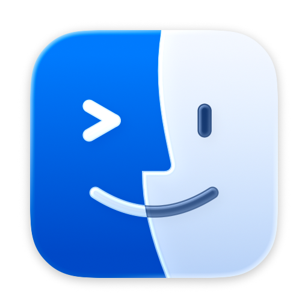
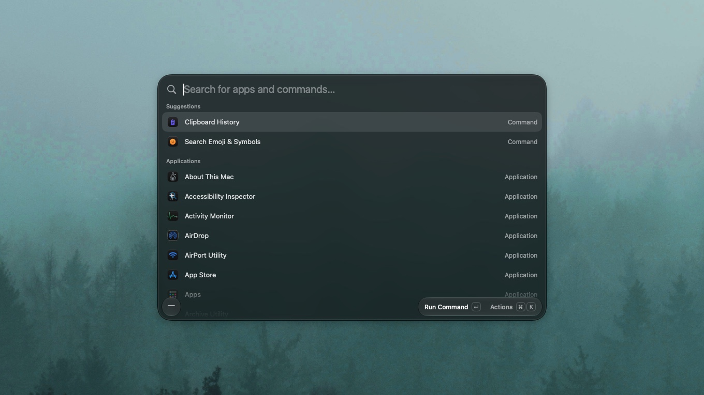
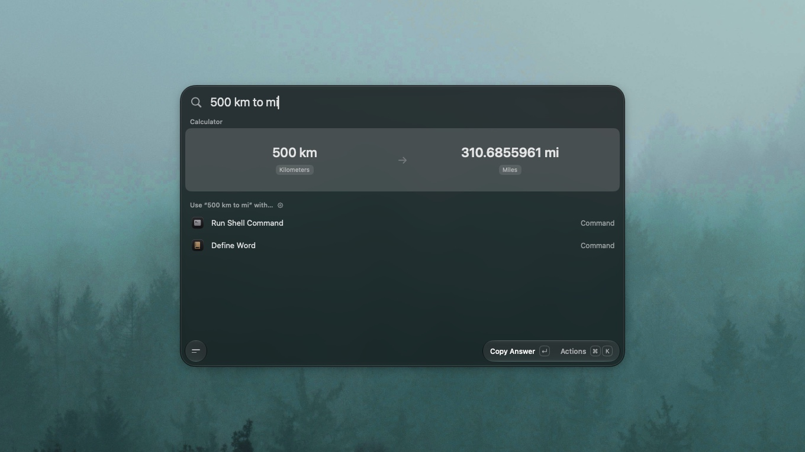
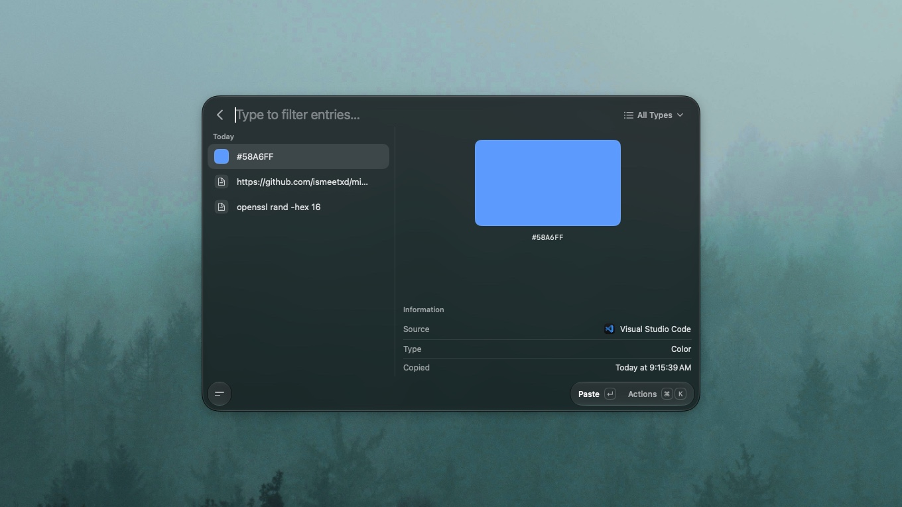
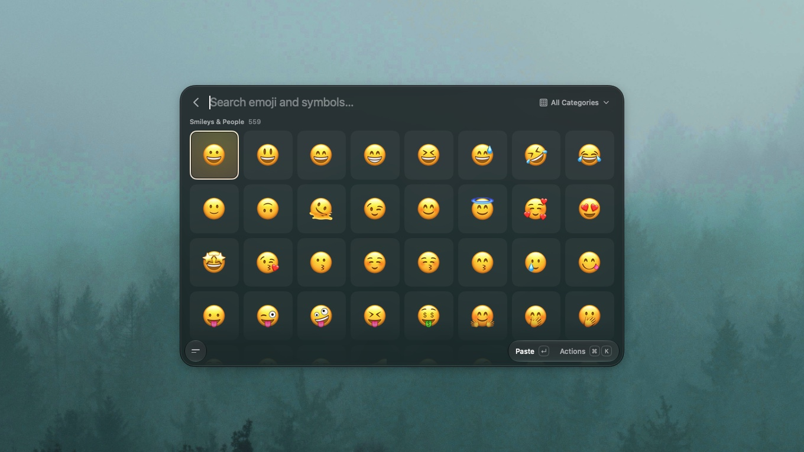
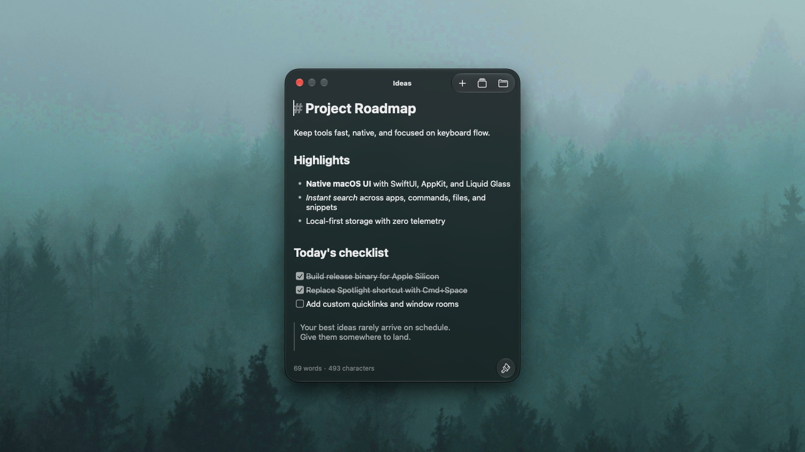

<h1 align="center">
  <br>
  Minicast
</h1>

<p align="center">
  A native macOS launcher built for productivity.
</p>

<p align="center">
  
  
  <a href="LICENSE"></a>
</p>

<p align="center">
  
</p>

Built natively with SwiftUI and AppKit — 100% pure Swift with zero third-party dependencies, no Electron, and no telemetry. Includes fuzzy app launching, global & per-app hotkeys, clipboard history (text, images, and OCR), inline calculator & currency conversion, window management & rooms, floating Markdown notes, text snippets, quicklinks, calendar schedule, menu-bar search, and local dictation.

## Product Demo

<table>
  <tr>
    <td width="50%" align="center">
      <strong>Inline Calculator &amp; Unit Conversion</strong><br><br>
      
    </td>
    <td width="50%" align="center">
      <strong>Clipboard History</strong><br><br>
      
    </td>
  </tr>
  <tr>
    <td width="50%" align="center">
      <strong>Emoji &amp; Symbols</strong><br><br>
      
    </td>
    <td width="50%" align="center">
      <strong>Floating Markdown Notes</strong><br><br>
      
    </td>
  </tr>
</table>

## Requirements

- **macOS 26 or later**
- **Xcode 27** (includes the Swift 6 toolchain, macOS SDK, and SwiftUI macro plugin)

## Build & Install for Mac

> [!NOTE]
> The Xcode project, scheme, bundle IDs, and local signing target still use `Tinycast` internally.

### 1. Clone the repository

```sh
git clone https://github.com/ismeetxd/minicast.git
cd minicast
```

### 2. Create the local code-signing identity (one time)

The Xcode project signs local builds with a self-signed certificate named `Tinycast Self-Signed` so macOS preserves Accessibility permissions across rebuilds (ad-hoc signing resets TCC permissions on every build). Run once in Terminal:

```sh
openssl req -x509 -newkey rsa:2048 -nodes -days 3650 \
  -keyout /tmp/tc-key.pem -out /tmp/tc-cert.pem \
  -subj "/CN=Tinycast Self-Signed" \
  -addext "basicConstraints=critical,CA:false" \
  -addext "keyUsage=critical,digitalSignature" \
  -addext "extendedKeyUsage=critical,codeSigning"

openssl pkcs12 -export -inkey /tmp/tc-key.pem -in /tmp/tc-cert.pem \
  -name "Tinycast Self-Signed" -out /tmp/tc.p12 -passout pass:tinycast

security import /tmp/tc.p12 -k ~/Library/Keychains/login.keychain-db \
  -P tinycast -A -T /usr/bin/codesign

rm -f /tmp/tc-key.pem /tmp/tc-cert.pem /tmp/tc.p12
```

Verify it is present:

```sh
security find-identity -p codesigning | grep "Tinycast Self-Signed"
```

### 3. Build and install

#### Option A: Build a Release `.dmg` and install to `/Applications`

```sh
swift Scripts/build-dmg.swift
open build/Tinycast-0.1.0.dmg
```

Drag the built `.app` bundle into `/Applications` and launch it.

> [!NOTE]
> If `xcode-select` points to Command Line Tools rather than Xcode, `Scripts/build-dmg.swift` and `Scripts/run-tests.swift` automatically use `/Applications/Xcode.app/Contents/Developer` when `DEVELOPER_DIR` is unset.

#### Option B: Build and run the Debug channel in Xcode

```sh
open Tinycast.xcodeproj
```

Select the **Tinycast** scheme and press **⌘R**, or build from the terminal:

```sh
DEVELOPER_DIR=/Applications/Xcode.app/Contents/Developer \
  xcodebuild -project Tinycast.xcodeproj -scheme Tinycast -configuration Debug build
```

Debug builds run under a separate development channel (`Tinycast Dev.app`, bundle ID `com.abueammar.tinycast.dev`) with isolated preferences, `Application Support`, and caches.

> [!NOTE]
> Self-signed local builds skip iCloud Sync (which requires an Apple Development team and provisioning profile in `Config/Local.xcconfig`). Everything else builds and runs locally.

### 4. First launch & permissions

On first launch, open onboarding or Settings to bind a global hotkey (e.g. `⌥Space`) and grant **Accessibility** permission when prompted so paste actions, window management, and global shortcuts work. Optional features (Clipboard OCR, Dictation, Calendar, File Search, Snippets) prompt for their corresponding macOS permissions only when enabled.

### 5. Replace Spotlight Search (`⌘Space`)

To make Minicast open with `⌘Space` instead of macOS Spotlight:

1. Open **System Settings → Keyboard → Keyboard Shortcuts… → Spotlight** and uncheck **Show Spotlight search** (this frees `⌘Space`).
2. In Minicast onboarding or **Settings → General**, click the hotkey recorder and press `⌘Space`.
3. Enable **Launch at login** in **Settings → General** so Minicast starts automatically with your Mac.

## Verification

```sh
swift Scripts/run-tests.swift
swift Scripts/check.swift
```

## License & Attribution

Minicast is licensed under the **[GNU Affero General Public License v3.0 (AGPL-3.0)](LICENSE)**, based on [Tinycast](https://github.com/abue-ammar/tinycast) (`Copyright (C) 2026 Abue Ammar`). Third-party licenses and attributions are preserved in [NOTICE.md](NOTICE.md).
